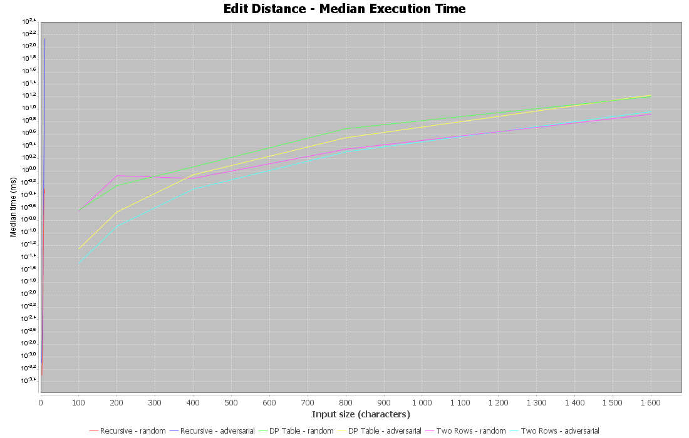
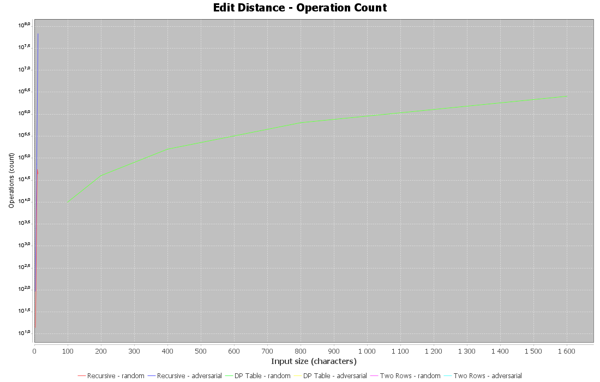
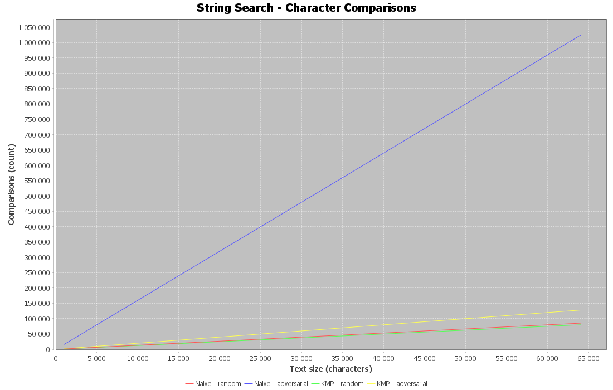
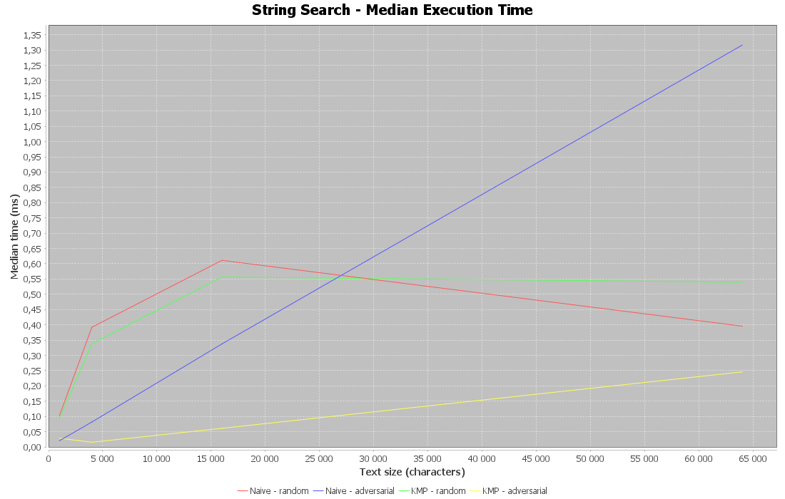

# DAA Assignment 4 — Experimental Report

## 1. Experiment Design Card

### Experiment 1: Edit Distance

**Research Question:** How do the recursive, full DP table, and two-row DP algorithms compare in execution time and operation counts as string length increases?

**Input Sizes:**

- Recursive: n = 3, 5, 7, 9, 11.
- DP Table and Two Rows: n = 100, 200, 400, 800, 1600.

Both strings will have length n.

**Input Types:**

1. Random strings generated from a fixed alphabet using seed 42.
2. Different repeated characters, such as "AAAA..." versus "BBBB...", to produce many mismatches and make the recursive algorithm perform more work.

**Metrics:**

- Execution time in milliseconds, measured using `System.nanoTime()`.
- Operation count collected inside each algorithm.

The recursive version will count recursive calls, while the DP versions will count computed table cells. These counters measure different kinds of work and will be interpreted accordingly.

**Prediction (Before Running):**

The recursive algorithm will become significantly slower as n increases because it repeatedly solves the same subproblems. Both DP versions should scale approximately quadratically. Two Rows should use less memory than the full DP Table, but it may not always be faster.

### Experiment 2: String Search

**Research Question:** How do Naive Search and KMP compare in execution time and character comparisons as text length increases?

**Input Sizes:**

n = 1000, 4000, 16000, 64000.

The pattern length will be 16 characters.

**Input Types:**

1. Random text and pattern generated with fixed seed 42.
2. Adversarial input: text consisting of repeated "A" characters and pattern consisting of 15 "A" characters followed by "B".

The adversarial input is designed to cause many repeated comparisons in Naive Search.

**Metrics:**

- Execution time in milliseconds.
- Character comparison count collected inside the algorithms.

**Prediction (Before Running):**

KMP should perform fewer character comparisons than Naive Search on adversarial inputs because it uses the LPS array to avoid repeating unnecessary comparisons. On short or random inputs, Naive Search may have similar or better execution time because it has less preprocessing overhead.

### Experimental Procedure

All experiments will use deterministic input generation with seed 42. Each algorithm and input configuration will be executed five times. Every run will be saved to `results/results.csv`, and the median execution time will be used for comparisons.

### Planned Plots

1. **Edit Distance: Input Size vs Execution Time** — a logarithmic time axis will help compare recursive and DP implementations.
2. **Edit Distance: Input Size vs Operation Count** — compare growth in recursive calls and DP cell computations.
3. **String Search: Input Size vs Character Comparisons** — compare Naive and KMP on random and adversarial inputs.
4. **String Search: Input Size vs Median Execution Time** — compare measured performance.

Each plot will include a title, labeled axes with units, and a one-sentence takeaway.

## 2. Experimental Results

The experiments were performed using Java 25. Each configuration was executed five times, and the median execution time was used for analysis. The results are stored in `results/results.csv`.

### Plot 1: Edit Distance — Execution Time

**Takeaway:** The recursive algorithm has exponential worst-case growth, while both dynamic programming implementations have quadratic time complexity. The algorithms were measured over different input-size ranges, so direct comparisons at the same n are not available.

### Plot 2: Edit Distance — Operation Count

**Takeaway:** Both DP implementations compute the same number of internal cells, while the recursive algorithm may perform many repeated calls. Recursive calls and DP cell computations represent different units of work.

### Plot 3: String Search — Character Comparisons

**Takeaway:** KMP is expected to require fewer character comparisons than Naive Search on adversarial inputs because it avoids repeated matching attempts using the LPS array.

### Plot 4: String Search — Execution Time

**Takeaway:** Execution time depends on input structure and runtime overhead. KMP has better worst-case complexity, but this does not guarantee that it is faster for every tested input.

## 3. Prediction vs Results

### Edit Distance

**Prediction:** The recursive algorithm would become significantly slower as input size increases, while DP Table and Two Rows would demonstrate quadratic growth.

**Results:** The operation-count graph shows that both DP implementations perform the same number of cell computations, increasing quadratically with input size. The execution-time graph shows increasing runtime for both DP implementations, with Two Rows generally performing faster in the measured configurations.

The recursive implementation was tested only on short strings because of its exponential worst-case complexity. Its results appear compressed near the left side of the graphs because the DP algorithms were tested on much larger inputs. Therefore, the experiment supports the expected DP growth pattern but does not provide a direct same-size timing comparison between recursion and DP.

### String Search

**Prediction:** KMP would outperform Naive Search on adversarial inputs, while Naive Search might remain competitive on random inputs.

**Results:** The measurements support this prediction. At a text length of 64,000 characters, Naive Search performed approximately 1,024,000 comparisons on adversarial input, compared with approximately 128,000 for KMP.

The median execution time was approximately 1.32 ms for Naive Search and 0.25 ms for KMP on the same adversarial input. This indicates that KMP was approximately five times faster in this measured configuration.

However, on random inputs, Naive Search was sometimes faster despite performing a similar number of comparisons. This suggests that KMP's preprocessing and control-flow overhead can outweigh its theoretical advantages on easier inputs.

Overall, the experimental results are consistent with the expected worst-case complexity differences between Naive Search and KMP.

## 4. Discussion

### Question 1: Which input was the slowest for String Search, and why?

The slowest measured input was the adversarial case for Naive Search with a text length of 64,000 characters. The text consisted entirely of repeated "A" characters, while the pattern contained 15 "A" characters followed by "B". This caused Naive Search to perform many repeated comparisons before detecting a mismatch. KMP handled this input more efficiently by using the LPS array.

### Question 2: What was the maximum input size handled by the recursive algorithm, and what stopped you from increasing it?

The largest tested input size for Recursive Edit Distance was 11 characters per string. The recursive implementation does not use memoization, so it repeatedly solves overlapping subproblems. Its worst-case execution time grows exponentially, making larger inputs increasingly expensive. Therefore, the recursive benchmark was limited to small input sizes, while the DP algorithms were tested up to 1,600 characters.

### Question 3: What are the trade-offs between Two Rows and the Full DP Table?

Both algorithms have O(n × m) time complexity and compute the same edit distance. The full DP Table uses O(n × m) memory because it stores every computed cell, making it easier to reconstruct the sequence of edits. Two Rows uses only O(min(n, m)) memory by keeping the previous and current rows. Two Rows is preferable when memory efficiency matters, while the full table is more convenient when the complete edit sequence is needed.

### Question 4: Which String Search algorithm would you choose for the city search platform, and why?

I would choose KMP for searching long texts because it guarantees O(n + m) worst-case time complexity. The experiments showed that KMP performed significantly fewer comparisons on adversarial inputs. However, Naive Search can still be practical for short or random inputs because it has less preprocessing overhead. For a platform that needs predictable performance on different input types, KMP is the safer choice between these two algorithms.

### Why We Measure Both Execution Time and Operation Counts

Execution time shows the actual performance of an algorithm on a particular computer, but it can be influenced by JVM optimization, system load, and other runtime factors. Operation counts provide a more stable way to examine how the amount of algorithmic work changes with input size. For Edit Distance, we counted recursive calls or computed DP cells, while for String Search, we counted character comparisons. These metrics are not always directly comparable across different algorithm families, but together with timing measurements, they help explain the observed performance.

## 5. Conclusion

In this assignment, I implemented and compared five algorithms: Recursive Edit Distance, DP Table, Two Rows Edit Distance, Naive String Search, and KMP String Search.

The experiments demonstrated the importance of algorithm selection. Both dynamic programming implementations showed quadratic growth in operation counts, while the recursive approach was limited to small inputs because of its exponential worst-case complexity. The Two Rows implementation reduced memory usage without changing the final edit distance.

For String Search, KMP performed significantly better than Naive Search on adversarial inputs. At a text length of 64,000 characters, KMP required approximately eight times fewer character comparisons and achieved a lower median execution time. However, Naive Search remained competitive on random inputs because of its simpler implementation and lower overhead.

Overall, the results showed that theoretical complexity, operation counts, and execution time should be considered together when evaluating algorithms. Dynamic programming is preferable for larger Edit Distance problems, while KMP provides more predictable worst-case performance for String Search.